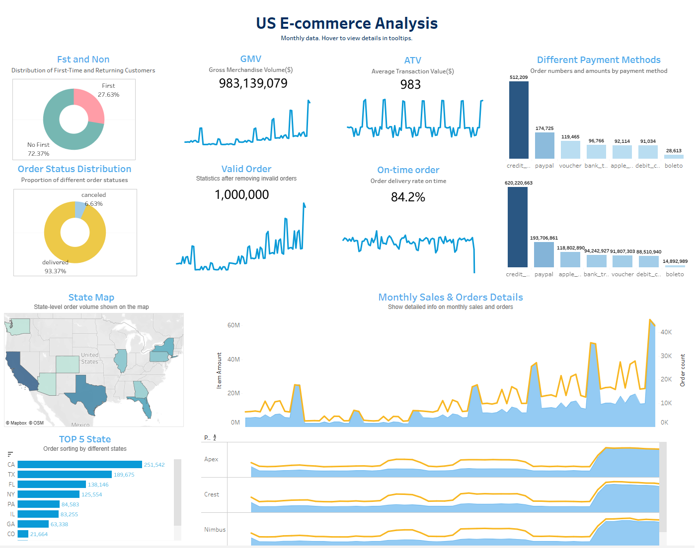

# US-Ecommerce-Analytics

**美国电商经营分析与客户价值分析**


基于约 100 万条美国电商订单（Kaggle 合成数据集）的端到端分析项目：Python 完成数据清洗，MySQL 承担分析层（销售、支付方式、地域、RFM 分层、同期群留存、商品表现），Tableau 输出一屏经营看板，覆盖收入、订单、履约与客户结构。

**在线看板：** [Tableau Public](https://public.tableau.com/app/profile/chen.chu6837)

---

## 看板



一屏 11 个视图，按月粒度，全部基于同一份 `fact_order` 提取数据。布局按阅读顺序回答四个问题：卖了多少（顶部 KPI 与趋势）→ 谁在买、怎么付（左侧环形图、右侧支付方式）→ 需求集中在哪（地图与州排名）→ 收入与订单量如何同步变化（双轴趋势、商品小倍数）。

### 核心指标

| 指标 | 数值 | 口径 |
| --- | --- | --- |
| GMV | **$983,139,079** | 有效订单 `Item Amount` 求和 |
| 有效订单 | **1,000,000** | 剔除无效记录后的订单数 |
| ATV | **$983** | GMV ÷ 有效订单数 |
| 准时交付率 | **84.2%** | 在承诺时效内送达 |
| 取消率 | **6.63%** | `Canceled` ÷ 全部订单 |
| 复购订单占比 | **72.37%** | 非首购订单 ÷ 全部订单 |
| 订单量最高州 | **CA — 251,542 单** | 州级订单量排名第一 |

### 视图构成

| 视图 | 图表类型 | 字段 | 回答的问题 |
| --- | --- | --- | --- |
| `GMV` | KPI + 月度趋势线 | `SUM(Item Amount)`、`Purchase Year Month` | 收入多少，水位是否在抬升 |
| `ATV` | KPI + 月度趋势线 | GMV ÷ 订单数 | 客单价是否稳定 |
| `Valid Order` | KPI + 月度趋势线 | 清洗后 `COUNTD(Order ID)` | 订单量是否跟得上收入 |
| `On-time order` | KPI + 月度趋势线 | 准时标记 | 履约可靠性是否在改善 |
| `Fst and Non` | 环形图 | `Order Status Group` | 拉新与复购的结构 |
| `Order Status Distribution` | 环形图 | `Order Status` | 妥投与取消的比例 |
| `Different Payment Methods` | 成对条形图（单量 + 金额） | `Payment Types` | 哪些支付方式在支撑交易 |
| `State Map` | 填充地图 | `Customer State` | 需求集中在哪些州 |
| `TOP 5 State` | 排序条形图 | `Customer State`、订单数 | 优先布仓与投放的州 |
| `Monthly Sales & Orders Details` | 双轴面积图 + 折线 | `Item Amount`、订单数 | 收入与订单量是否同向 |
| `Product detail trend` | 小倍数图（Apex / Crest / Nimbus） | `Product`、月份 | 哪条商品线在加速 |

### 交互设计

- **全局日期筛选器**：`Purchase Date` 的范围滑块作用于看板上全部工作表，一个控件统一所有 KPI 与图表的时间窗口。
- **跨图悬停高亮**：以 `Order Status`、`Customer State`、`Payment Types`、`Order Status Group`、`Purchase Year Month` 为匹配字段，悬停某条标记时其余图表中同维度数据高亮、不匹配的淡出，但数据不会被删掉，对比基准一直在。
- **筛选与高亮分开**：日期滑块负责裁数据，高亮动作只负责变色。两者混在一个控件里，看板就会变得不可预测，这是最常见的设计失误。
- **自定义工具提示**：按月展示销售额、订单数、ATV、准时率，紧凑的 KPI 卡也能读到明细。

---

## 主要结论

1. **增长靠订单量，不靠客单价。** $983,139,079 的 GMV 对应 1,000,000 有效订单，ATV $983；双轴图上月度 GMV 与订单数几乎同向，最近一轮抬升是订单量在推。
2. **履约是短板。** 妥投占 93.37%、取消仅 6.63%，但准时率只有 84.2%，大约每六单就有一单错过承诺时效。可改善的空间在时效，不在取消。
3. **生意偏复购驱动。** 复购订单占 72.37%，首购 27.63%。增长模型应把复购与沉睡唤醒放在拉新之前。
4. **支付方式高度集中。** 信用卡在单量和金额上都排第一（512,209 单 / $620,220,663），PayPal 第二（174,725 单 / $193,706,861），boleto 几乎可以忽略（28,613 单 / $14,892,989）。支付优化与失败监控先做前两个。
5. **需求集中在少数州。** 加州一州约占有效订单的 25%（251,542 单），其后是德州 189,675、佛州 138,146、纽约 125,554、宾州 84,584。布仓、库存与州级投放按这个顺序排。
6. **三条商品线同时拐头。** Apex、Crest、Nimbus 在最后一个周期一起上台阶，更像平台层面的需求变化，而不是单品爆发。

---

## 数据流程


### 数据清洗

- 剔除 `Purchase Date` 缺失、客户主键为空、`Item Amount` 非正的记录。
- 按 `Order ID` 去重；重复记录冲突时保留最新一条。
- 统一支付方式标签（`credit_card`、`paypal`、`apple_pay`、`bank_transfer`、`debit_card`、`voucher`、`boleto`），州名映射为两位 USPS 代码。
- 派生下游要用的分析字段：`Purchase Year Month`、配送时长、准时标记、`Order Status Group`（首购 / 非首购）。

### 客户价值（RFM）

最近一次购买、购买频次、消费金额各按五分位打 1–5 分，组合成客户分层，用于确定复购预算与唤醒名单的优先级。结果放在 `sql/` 与 `notebooks/`，不进经营看板，看板只留运营指标。

### 留存（同期群）

按首购月份分组，逐月跟踪后续周期的留存，把真实留存和拉新带来的增长分开看。

### 商品表现

对比各商品线的收入、单量与均价，用小倍数图定位最近一次拐点来自哪条线。

---

## 数据集

[Kaggle — Synthetic U.S. E-commerce Dataset (1M Orders)](https://www.kaggle.com/datasets/limjeongeun/synthetic-u-s-e-commerce-dataset-1m-orders)

| 类型 | 字段 |
| --- | --- |
| 原始 | `Order ID`、`Purchase Date`、`Customer ID`、`Customer State`、`Order Status`、`Payment Type`、`Product`、`Item Amount` |
| 派生 | `Purchase Year Month`、`Order Status Group`、配送时长、准时标记 |

数据集为合成数据：适合演示方法，但不含营销费用、毛利与退货，因此 CAC、利润与退款分析不在范围内。

---

## 技术栈

| 层次 | 工具 | 用途 |
| --- | --- | --- |
| 数据准备 | Python（pandas、NumPy） | 清洗、类型处理、派生字段、导出 |
| 存储与分析 | MySQL 8 | 星型表存储、窗口函数分析、RFM 与同期群查询 |
| 可视化 | Tableau Desktop / Public | 提取、看板、动作、发布 |
| 文档 | Markdown、Mermaid | 复现说明与流程示意 |

---

## 仓库结构

```
.
├── README.md                  # 中文说明（本文件）
├── README.en.md               # 英文版
├── docs/
│   └── dashboard-preview.png
├── data/
│   ├── raw/                   # Kaggle 原始 CSV（不提交）
│   └── processed/             # 清洗结果 / hyper 提取
├── notebooks/
│   ├── 01_cleaning.ipynb
│   ├── 02_rfm.ipynb
│   └── 03_cohort.ipynb
├── sql/
│   ├── schema.sql
│   ├── sales_overview.sql
│   ├── rfm_segments.sql
│   └── cohort_retention.sql
├── tableau/
│   └── us_ecommerce_dashboard.twbx
└── requirements.txt
```

---

## 复现步骤

1. 从 Kaggle 下载数据集，CSV 放到 `data/raw/`。
2. `pip install -r requirements.txt`，按顺序跑 `01` → `03` 三个 notebook。
3. 用 `sql/schema.sql` 建表并导入清洗结果，再执行分析查询。
4. 打开 `tableau/us_ecommerce_dashboard.twbx`，把提取指向 `data/processed/` 后刷新。
5. 发布：**服务器 → Tableau Public → 保存到 Tableau Public**。发布前必须把连接改成**提取**，Public 不接受实时连接。

---

## 制作细节（Tableau）

- **环形图**用两条 `MIN(0)` 轴堆叠，**同步轴并把范围固定为 −1…1**，再叠一个不带维度的白色圆作遮罩。范围一致且固定，环才是正圆；否则看板一压缩，环就左偏、被压扁。
- **遮罩圆不加任何维度、关闭工具提示**，否则鼠标移到空心处会弹出空的 `Aggregate 0`。
- **跨图联动用高亮而不是筛选**：悬停即筛选会把对比基准删掉，还被迫依赖"点空白处复位"这种隐式操作。
- **环形图与 KPI 卡放在正方形浮动容器里**，Tableau Public 上缩放时比例才不会走形。

---

## 局限与后续

- 缺营销费用、毛利、退货数据，项目止步于收入与运营效率，不涉及盈利。
- 州级需求只做了描述，没有引入人口、物流成本等解释变量。
- 下一步：把同期群热力图与 RFM 分层放进第二个看板页；加参数切换月 / 季度粒度；给准时率设预警阈值；把固定的 Top-N 州改成参数控制。

---

## 联系方式

**作者：** 陈初
**邮箱：** chen3242022@163.com
**Tableau Public：** https://public.tableau.com/app/profile/chen.chu6837


# US-Ecommerce-Analytics
U.S. E-commerce Business Analytics & Customer Value Analysis
## Project Overview

An e-commerce business analytics project based on a synthetic U.S. e-commerce dataset containing approximately 1 million orders.

## Objectives

- Analyze overall sales performance and business trends.
- Segment customers using RFM analysis.
- Evaluate customer retention using Cohort analysis.
- Analyze product sales and profitability.
- Develop interactive business intelligence dashboards using Tableau.

## Tech Stack

- Python (Pandas, NumPy)
- MySQL
- Tableau

## Project Structure

- `data/`: Raw and processed datasets
- `notebooks/`: Python data processing and analysis
- `sql/`: SQL queries and business analysis
- `tableau/`: Tableau dashboards
- `reports/`: Analysis reports

## Dataset

[Kaggle - Synthetic U.S. E-commerce Dataset (1M Orders)](https://www.kaggle.com/datasets/limjeongeun/synthetic-u-s-e-commerce-dataset-1m-orders)


